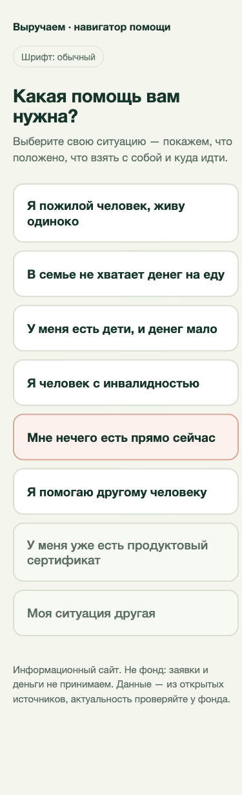
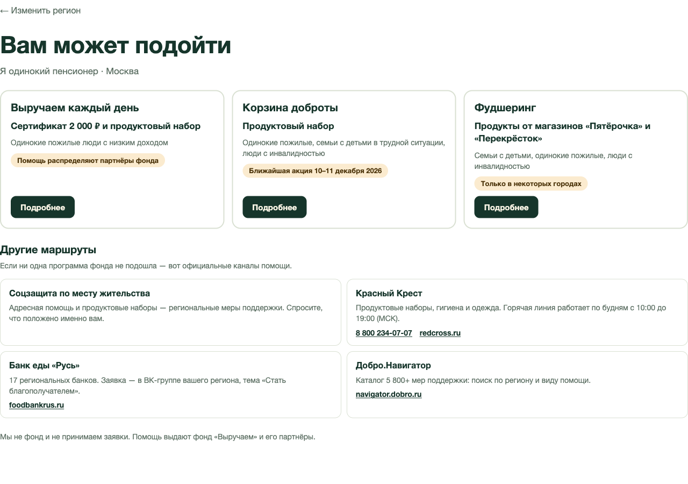

# Навигатор продуктовой помощи

[](https://github.com/Pioneer113/vyruchaem-navigator/actions/workflows/ci.yml)

Сайт-подсказка для людей в трудной ситуации: человек выбирает свою ситуацию и регион — и за минуту узнаёт, какая помощь фонда X5 «Выручаем» ему положена, что взять с собой и куда идти.

**Демо:** https://pioneer113.github.io/vyruchaem-navigator/

 

## Проблема и решение

Люди, которым не хватает денег на еду, не знают, какая помощь им положена и куда идти. У фонда «Выручаем» есть программы — продуктовые наборы и сертификаты 2 000–5 000 ₽, — но на сайте фонда нет публичной страницы «получить помощь», а помощь раздают 118 НКО-партнёров.

Навигатор собирает это в один простой вход: **ситуация → регион → карточка программы → маршрут в три шага**. Без регистрации, форм и сбора персональных данных.

## Что умеет

- шесть ситуаций + «моя ситуация другая»;
- выбор региона (85 субъектов), Москва и Санкт-Петербург — крупными кнопками;
- карточки четырёх программ фонда: что дают, кому подходит, три шага получения, что взять с собой, скрипт «что сказать», срок и источник;
- срочный экран «если еды нет совсем»: 112, соцзащита, Красный Крест, банк еды «Русь», карты пунктов помощи;
- блок «другие маршруты», если программы фонда не подошли;
- печатная памятка A4 с QR-кодом;
- увеличение шрифта и подсказки при отключённом JavaScript.

## Польза для Фонда

- **публичный вход** к программам фонда, которого у него сейчас нет;
- каждый маршрут ведёт в реальные каналы: заявка на елкажеланий.рф, соцзащита, НКО-партнёры;
- **честные данные**: на каждой карточке указан источник и дата проверки, нет выдуманных адресов и телефонов;
- контент обновляется без программиста — один файл данных.

## Данные и их актуальность

Все данные — из открытых официальных источников; проверено 26.11.2026.

| Источник | Что взято |
|---|---|
| выручаем.рф | программы фонда, «Выручаем каждый день» |
| корзинадоброты.рф | механика «Корзины доброты», справочная линия |
| праздникнастол.рф, елкажеланий.рф | «Праздник на стол»: сроки, документы, условия |
| esg.x5.ru | фудшеринг |
| foodbankrus.ru | банк еды «Русь», регионы и маршрут заявки |
| redcross.ru | Красный Крест, линия помощи |
| navigator.dobro.ru | Добро.Навигатор |

Список 118 НКО-партнёров фонда не публичен, поэтому в продукте нет выдуманных партнёрских адресов: маршрут идёт через соцзащиту и официальные каналы. Сайт **не является фондом** и не принимает заявки или деньги.

## Внедрение в Фонд: подключение реестра НКО-партнёров

Сайт готов принять реестр партнёров фонда без переписывания кода: в `src/data/partners.ts` есть тип `PartnerOrg`, пустой реестр `PARTNERS` и фильтрация `partnersForRegion()`. Фонд заполняет реестр из своего списка 118+ НКО — и статический сайт становится публичным входным окном платформы продовольственной помощи.

Пример одного объекта формата (структура записи, не реальная организация):

```json
{
  "id": "nko-example",
  "name": "Название НКО-партнёра",
  "regionId": "tula",
  "city": "Тула",
  "programs": ["korzina", "foodshare"],
  "channelUrl": "https://example.org/request",
  "phone": "8 800 000-00-00",
  "acceptingRequests": true,
  "verifiedAt": "2026-12-01"
}
```

- `regionId` — id региона из `REGIONS` (`src/data/index.ts`);
- `acceptingRequests` — `true` только если партнёр принимает новые заявки; `false` скрывает организацию из выдачи;
- `verifiedAt` — дата последней проверки данных партнёра.

После заполнения блок «Проверенные организации в вашем регионе» появляется на экране результатов и на карточке программы автоматически. Пустой реестр ничего не ломает: сайт показывает текущие честные маршруты через соцзащиту и официальные каналы.

## Как обновлять контент

1. Откройте `src/data/index.ts`.
2. У программы обновите тексты и `verifiedAt` (дата проверки), при необходимости `deadline` и `statusNote`.
3. Запустите `npm test` и `npm run build`.
4. Изменения — через pull request (CI обязателен).

## Запуск

```bash
npm install
npm run dev
npm test
npm run build
```

## Технологии

React 18 + Vite + TypeScript, статика без бэкенда, hash-маршрутизация, контент в одном файле данных, GitHub Actions для CI и деплоя на GitHub Pages, лицензия MIT.

## Структура

```
src/app/      маршрутизация, память региона, размер шрифта
src/data/     программы, ситуации, регионы, маршруты
src/screens/  экраны приложения
src/assets/   QR-код для памятки
public/       favicon
docs/         скриншоты
```

## Процесс разработки

- каждый pull request проходит CI (тесты + сборка) и ревью CodeRabbit на русском языке;
- ветка `main` защищена: прямые пуши, force-push и удаление запрещены;
- проект создан специально для конкурса «Вайбкодинг добрых дел» (23.11–07.12.2026) в Claude Code с виджетом конкурса. CodeRabbit использовался для ревью пул-реквестов; изменения кода вносились в Claude Code с включённым виджетом.

## Ограничения

- не фонд: заявки и деньги не принимает, персональные данные не собирает;
- нет аналитики и сторонних трекеров;
- нет каталога НКО — он не опубликован;
- не заменяет консультацию соцзащиты; актуальность данных проверяйте у фонда.

## Возможное развитие

- карта НКО-партнёров, когда фонд откроет публичный список;
- больше программ и региональных мер;
- английская версия для волонтёров-иностранцев.

## Лицензия

MIT.
